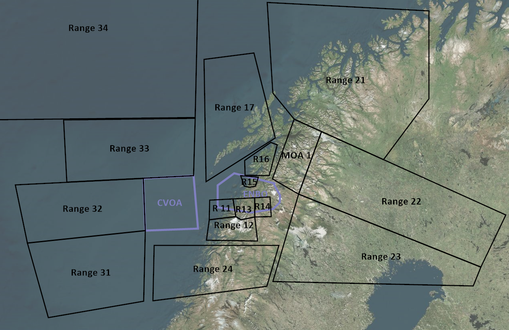

## Welcome to TRMA

The 132nd Virtual Wing is based at Bodø Airbase, Norway. The 132nd conducts local training, advanced training and scenario training in the territory of Norway, Sweden and Finland.

### Important information
* [How-to for external particpants](/ATRM_Brief/Pages/External.html)  
* [Carrier admin](PAGES/Carrier.md)
* [Navigation (FLIP ENBO CHARTS)](https://cloud.132virtualwing.org/s/q6PXgN7kwj9feem)  have those on your kneeboard!
* [Navigation (FLIP other CHARTS)](https://cloud.132virtualwing.org/s/my92eGXa9NbLXKz)
* [CombatFlite file for planning](PAGES/TRMA%20Combatflite%20file.cf)
* NEW! [MissionPlot file for planning](PAGES/TRMA_MissionPlot_File_v2.ttm) Added 10/2026
* [Red Force Doctrine/Intelligence](INTELLIGENCE/INTELLIGENCE.html) 
* [Communication (frequencies, presets, datalink](COMMUNICATIONS/PRESETS.md)  
* [Standing SPINS](PAGES/TRMA%20STANDING%20SPINS.pdf)
* [Tanker information](PAGES/Tanker.html)
* [Airspace boundaries in Tacview](https://cloud.132virtualwing.org/s/2tGEax7xEqYGAXy)  NOT UPDATED
* [Target List](PAGES/Targetlist.html)  
* [Air 2 Air Advesaries](PAGES/A2A.md)
* [ACM Training](PAGES/ACM-Training.md)

## Exercises (Not updated from ATRM)
The 132nd host various advanced training exercises.  
 
TO BE COMPLETED ONCE WE CREATE ADVANCED EXERCISE SCENARIOS 

## Taskings
Available taskings/scenarios:  <!--- sorted by tasking type, then range -->
* [Strike+OCA Escort, range 23](TASKINGS/132nd%20Strike%20and%20OCA%20Escort%20v1.0%20TRMA.pdf)
* [EXERCISE RED THUNDER A: Strike+OCA Escort+SEAD (with human aggressor), range 23](TASKINGS/EX%20RED%20THUNDER%20A%20-%20Strike-SEAD-Escort%20and%20aggressors%20in%20range%2023.pdf)
* [EXERCISE RED THUNDER B: Strike+SEAD (without air threat), range 23](TASKINGS/EX%20RED%20THUNDER%20B%20-%20Strike%20and%20SEAD%20in%20range%2023.pdf)
* [EXERCISE GREEN SHIELD](TASKINGS/EX_Green_Shield.md)

## RANGES
[Range 11](RANGES/Range11.html) | [Range 12](RANGES/Range12.html) |[Range 13](RANGES/Range13.html) |[Range 14](RANGES/Range14.html) |[Range 15](RANGES/Range15.html) |[Range 16](RANGES/Range16.html)| [Range 17](RANGES/Range17.html)|
[Range 21](RANGES/Range21.html) | [Range 22](RANGES/Range22.html) |[Range 23](RANGES/Range23.html) |[Range 24](RANGES/Range24.html) |
[Range 33](RANGES/Range33.html) | [Range 34](RANGES/Range34.html) |

<!---->

